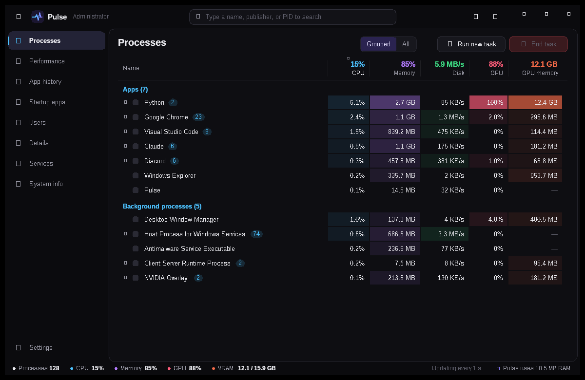
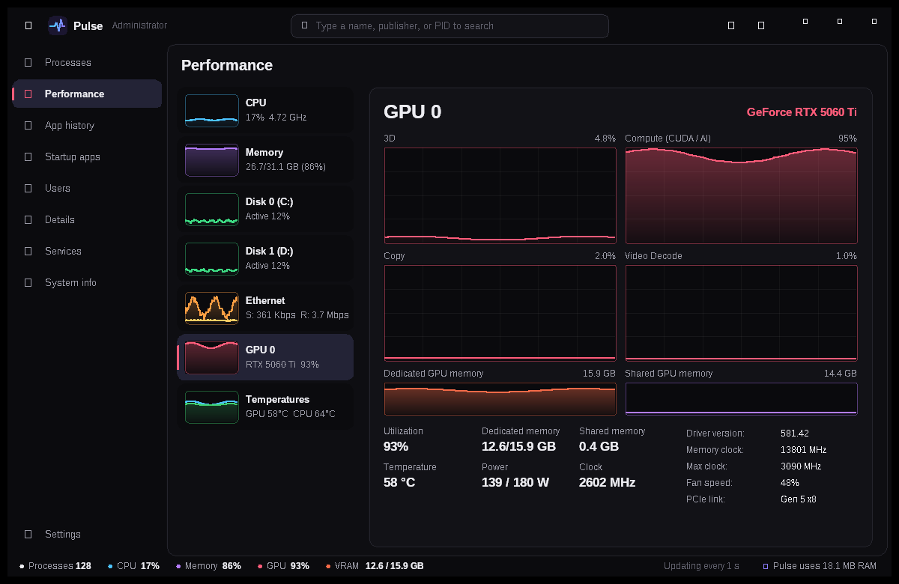
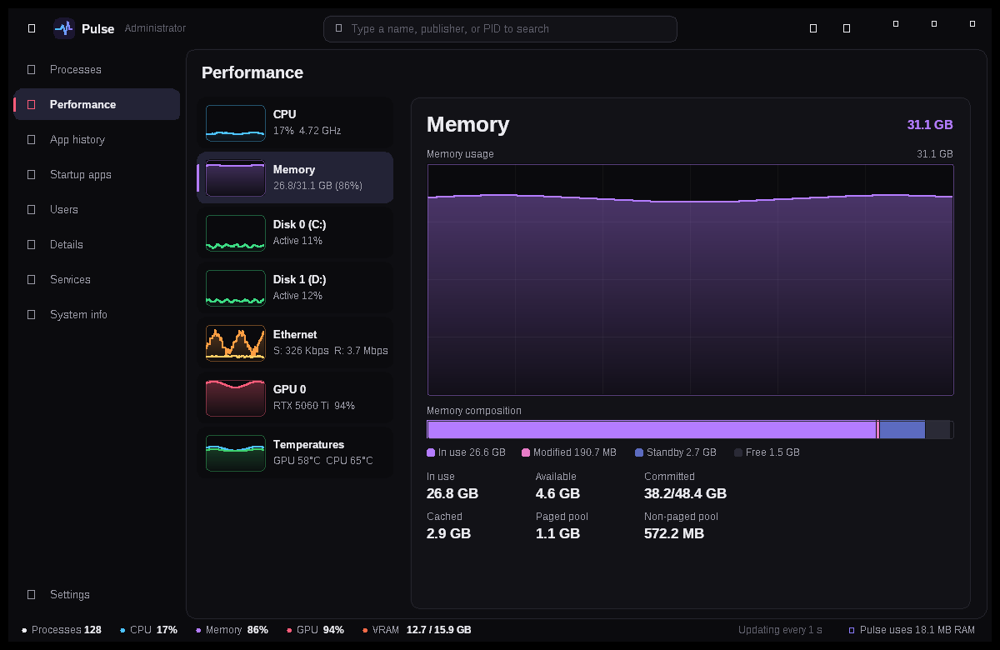
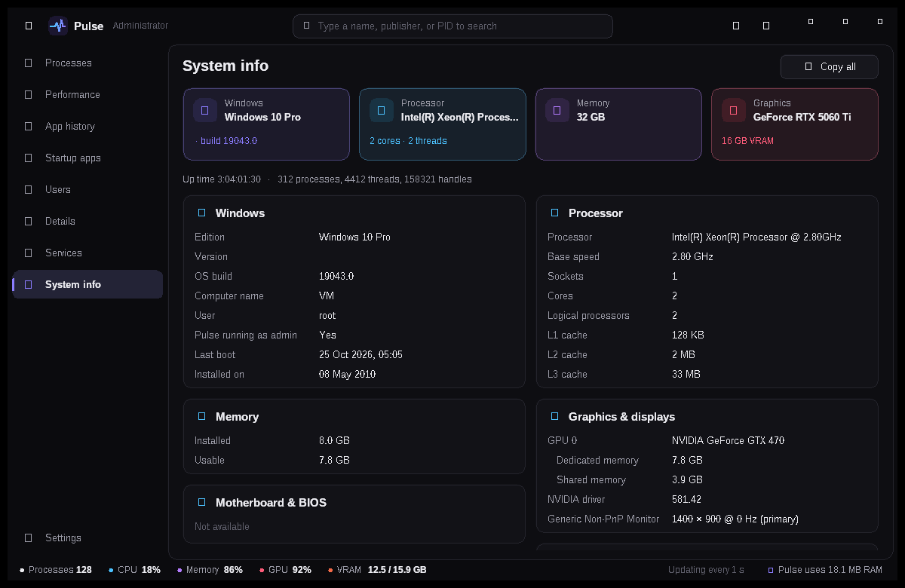
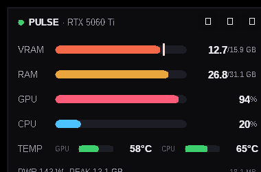

<p align="center"></p>

<h1 align="center">Pulse — a lightweight, colorful Task Manager alternative for Windows</h1>

<p align="center">
A fast, native <b>Windows Task Manager replacement</b> with live <b>CPU, RAM, GPU and VRAM monitoring</b>, per-app GPU memory, temperatures, startup apps, services and full system information — in a single ~3 MB <code>.exe</code> that uses only a few MB of RAM.
</p>

<p align="center"></p>

## Why Pulse?

The built-in Windows Task Manager doesn't tell you **which app is eating your VRAM**, hides GPU temperature and power, and isn't great to keep on screen while you game, render or run AI tools like ComfyUI or Stable Diffusion. Pulse fixes that:

- **Native and tiny** — written in Go on top of Win32/GDI+. No .NET, no Electron, no browser engine, no Python. One portable `.exe`, low memory, low CPU.
- **Everything Task Manager does** — Processes, Performance, App history, Startup apps, Users, Details and Services, in the same familiar layout.
- **Built for GPU users** — per-process **GPU %** and **GPU memory (VRAM)**, NVIDIA temperature, power draw vs. limit, clocks, fan speed, PCIe link, and separate 3D / Compute (CUDA) / Copy / Video graphs.
- **Black and colorful** — a dark theme where every resource has its own color, with heat-map columns so heavy apps stand out.
- **Compact widget** — a small always-on-top meter (VRAM, RAM, GPU, CPU, temperatures) you can drag anywhere.

## Features

| Page | What you get |
|---|---|
| **Processes** | Apps / background / Windows processes grouped like Task Manager, with icons. CPU, memory, disk, GPU and GPU memory per app. Search by name, publisher or PID. Right-click to end a task or process tree, set priority, open the file location, search online or view properties. |
| **Performance** | Live graphs for CPU (overall or per logical processor), memory (with composition bar), every disk, network adapters, GPU engines and temperatures. |
| **App history** | CPU time, disk read/write and GPU time per app, kept across restarts. |
| **Startup apps** | Enable or disable programs that start with Windows (Task-Manager-compatible). |
| **Users** | CPU, memory, disk, GPU and VRAM per signed-in user; disconnect or sign off. |
| **Details** | Every process with PID, user, CPU time, private memory, working set, VRAM, threads, handles, priority and architecture. |
| **Services** | Start, stop and restart Windows services, with description and startup type. |
| **System info** | Windows edition/build, CPU and caches, RAM sticks (type, speed, maker), motherboard and BIOS, GPU and driver, displays, drives and network addresses — copy it all with one click. |
| **Compact widget** | Tiny always-on-top monitor with bars or mini graphs and a VRAM peak marker. |

<p align="center">


</p>
<p align="center">


</p>

## Download & run

1. Download `Pulse.exe` from the [Releases](../../releases) page.
2. Double-click it. No installation and no dependencies are needed.
3. Windows SmartScreen may say *"Windows protected your PC"* because the app isn't code-signed yet: click **More info → Run anyway**.

Optional: **Settings → Restart as admin** lets Pulse end protected processes, control services and change machine-wide startup apps. **Settings → Start with Windows** launches it at sign-in.

**Requirements:** Windows 10 or 11 (64-bit). GPU details need an NVIDIA GPU with a current driver. Other GPUs still show usage and memory through Windows counters.

### Keyboard shortcuts

| Keys | Action |
|---|---|
| Ctrl+F or just start typing | Search |
| Delete | End selected task |
| ↑ / ↓ / PgUp / PgDn | Move selection |
| Ctrl+1 … Ctrl+9 | Switch page |
| F5 | Refresh now |

## Build from source

You need [Go](https://go.dev/dl/) 1.22 or newer, on any OS:

```bash
GOOS=windows GOARCH=amd64 go build -ldflags "-H windowsgui -s -w" -o Pulse.exe .
```

Run `Pulse.exe --demo` to see the UI with sample data.

### Project layout

```
main.go     entry point
win/        raw Win32 bindings (user32, GDI/GDI+, kernel32, PDH, NVML, registry, services, DXGI)
sys/        data collection: CPU, memory, disks, network, GPU, processes, users, services,
            startup apps, app history, system info
ui/         small drawing layer: canvas, text, charts
app/        the window: frame, table widget, one file per page, compact widget, settings
res/        icon and manifest (compiled into rsrc_windows_amd64.syso)
```

Settings and app history are stored in `%LOCALAPPDATA%\Pulse`.

## FAQ

**Is Pulse a full Task Manager alternative?**
Yes. It covers the same tabs as Windows Task Manager and adds per-app VRAM, GPU temperature/power and a compact widget.

**How much memory does it use?**
Very little: it's a single native executable with no runtime. The status bar shows Pulse's own memory use live.

**Does it show CPU temperature?**
It reads the Windows thermal-zone sensor, which is an approximation on many PCs. GPU temperature comes straight from the NVIDIA driver.

**Is it safe?**
It's open source: everything it does is in this repository. It only reads system information, and changes things only when you ask (end task, priority, services, startup apps).

## License

[MIT](LICENSE)

---

<sub>Keywords: task manager alternative, Windows Task Manager replacement, lightweight task manager, process explorer alternative, system monitor for Windows, GPU monitor, VRAM monitor, GPU memory usage per process, NVIDIA GPU temperature monitor, resource monitor, open source task manager.</sub>
